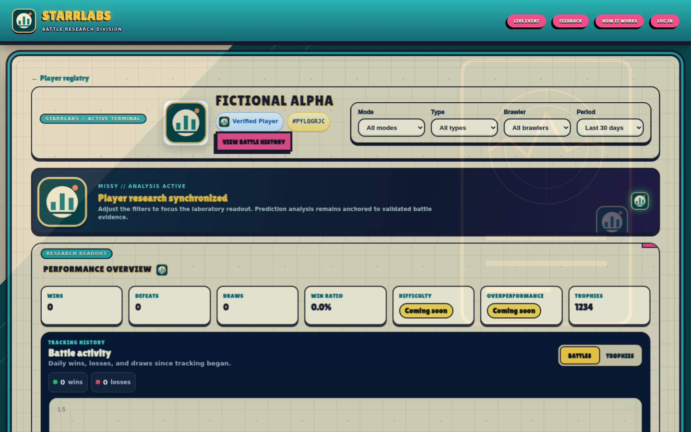
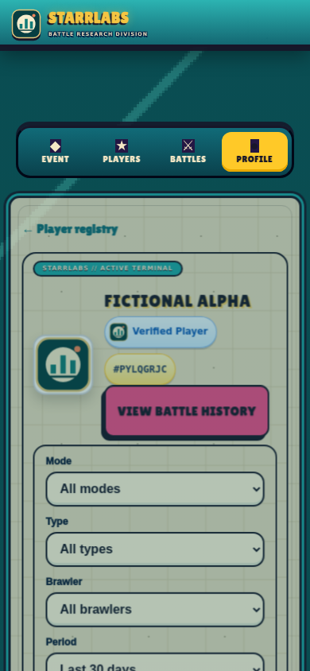
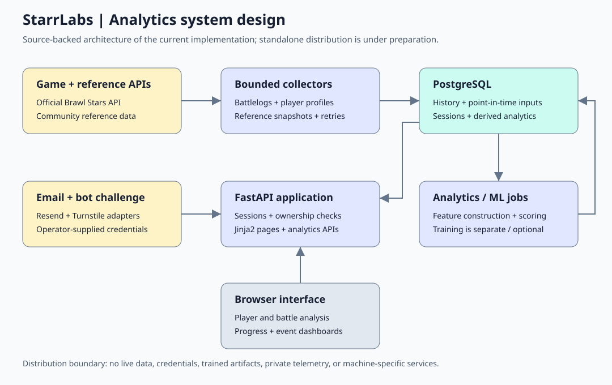

# StarrLabs

**Self-hosted Brawl Stars analytics: your database, your credentials, your data.**

StarrLabs turns short-lived game API observations into durable, explainable analytics. It combines a FastAPI/Jinja2 interface, PostgreSQL history, point-in-time inputs, verified player ownership, private/shared lists, descriptive metrics and optional separate model-training/scoring pipelines.

> Self-hosted source release. Clean installation, database initialization, ownership isolation, explicit public sharing and concurrent budgets pass on Linux/Python 3.12/PostgreSQL 17. Eighteen focused desktop/mobile Chromium checks pass using captured application HTML and synthetic API responses. WebKit could not start because its test host lacks a required library; Safari support, live provider delivery and production security are not certified. See [verification scope](docs/VERIFICATION.md).

**Maintainer:** [Cristian Guzman Urrutia (@crisguzu)](https://github.com/crisguzu). This owner-authorized public source edition was prepared and hardened with AI assistance; see [source provenance](PROVENANCE.md). Contribution statements do not imply solo authorship of every component.

**Review path:** [Local installation](#local-installation) · [Observed verification and limits](docs/VERIFICATION.md) · [Architecture/source map](docs/architecture.md). **Stack:** Python, FastAPI/Jinja2 and PostgreSQL; optional ML remains separate.

## Reproducible data-product case study

[Contract, SQL metric and one-command PostgreSQL walkthrough](docs/DATA_CONTRACT.md): fictional observations → content-addressed raw records → deduplicated battle grain → actual point-in-time view → win-rate/context-coverage metrics. No provider credentials; isolated disposable database only. This is a four-row correctness example, not a performance benchmark.

## Screenshots (fictional demo)

Actual application UI with a fictional player and synthetic API responses—not live player records or a hosted service. Empty charts are intentional demo state, not performance claims.

**Desktop profile**

**Mobile profile**

[Capture details and limitations](docs/screenshots/README.md).

## System design

[Architecture and source map](docs/architecture.md) · [Standalone diagram](docs/architecture.html) · [Security boundaries](SECURITY.md)

### Engineering focus

- Versioned, point-in-time game/reference observations and explicit bounded ingestion.
- Verified email sessions plus in-game ownership for private owner actions; selecting a public tag is not authorization.
- Explicit public sharing; non-public tokens disclose neither list content nor metadata.
- Bounded database checkout, transactional admission budgets, same-origin mutations and fail-closed secrets.
- Separate descriptive scoring and optional ML experiments. No trained weights, real datasets, accuracy or calibration guarantees are shipped.
- No autonomous scheduler, owner telemetry, private operator console or dependency on the original installation.

## Local installation

Prerequisites: Python 3.12 and a dedicated **empty PostgreSQL 17 database** with an operator-owned role. Create the database/role using your own administration tools. Do not point the initializer at a valuable existing database.

    git clone https://github.com/crisguzu/StarrLabs.git
    cd StarrLabs
    python3.12 -m venv .venv
    . .venv/bin/activate
    python -m pip install -r requirements.txt
    cp .env.example .env
    python scripts/generate_local_secrets.py

Edit the DB fields in .env with your own database credentials. The secret helper preserves existing non-placeholder secrets, writes no values to the console, and restricts .env to mode 0600. Never commit .env.

    python scripts/init_db.py --confirm-empty
    uvicorn main:app --host 127.0.0.1 --port 8000 --workers 1

Open http://127.0.0.1:8000. Run commands from the repository root. The supported collector deployment is a **single application worker**; connection/job caps must not be treated as a multi-worker distributed queue. The initializer refuses a non-empty public schema. For deliberate upgrades, review migrations and backups before using scripts/apply_migrations.py.

### Enable your own integrations

Basic pages start without external provider credentials. Sign-in and account linking need your own:
- Brawl Stars API token and provider-approved network/IP configuration: https://developer.brawlstars.com/
- Turnstile site/secret keys for your allowed hostname.
- Resend API key and a verified sender in STARRLABS_EMAIL_FROM.

Configure STARRLABS_ALLOWED_HOSTS, STARRLABS_ALLOWED_ORIGINS and optional STARRLABS_TURNSTILE_HOSTNAMES consistently. Remote hosting requires HTTPS, SESSION_HTTPS_ONLY=1, reviewed ingress/proxy settings and operational security; local smoke tests do not certify that deployment.

Collection and remote game images are **off by default**. Enable STARRLABS_COLLECTION_ENABLED=1 only after reviewing API quotas, player consent, retention and job limits. Remote image opt-in is separate: STARRLABS_REMOTE_MEDIA_ENABLED=1 requires applicable fan-content terms and notices. No schedules, live collection or training are installed automatically.

## Tests and optional ML

    python -m pip install -r requirements-test.txt
    python -m unittest discover -s tests -p test_access_policy.py

The isolated schema/application checks require PostgreSQL 17 binaries and protected executable RAM-backed scratch on Linux. See [verification scope](docs/VERIFICATION.md). They create and terminate their own disposable cluster; they do not use an existing database or contact game/email providers.

Training is optional and separate:

    python -m pip install -r requirements-ml.txt

Use only your authorized data and trusted, integrity-verified model artifacts. The optional joblib model format can execute code when loaded. Scientific training dependencies and model performance are not covered by the minimal-runtime acceptance.

## Privacy, assets and licensing

No real player/account records, secrets, databases, datasets, model weights, personal photographs, invitation codes, private history or deployed service definitions belong in this distribution. Operators must define access, retention, deletion, backups and provider disclosures for their own records. Do not attach real data or tokens to issues.

Original code/documentation and original neutral SVG assets are [MIT licensed](LICENSE). Lilita One retains its full SIL OFL 1.1 license. Pinned local chart packages retain their upstream MIT notices. Existing unverified/generated artwork and Supercell/FanKit binaries are not bundled. See [third-party notices](THIRD_PARTY_NOTICES.md).

This material is unofficial and is not endorsed by Supercell. See [Supercell’s Fan Content Policy](https://supercell.com/en/fan-content-policy/). No code license relicenses third-party trademarks or game imagery.
